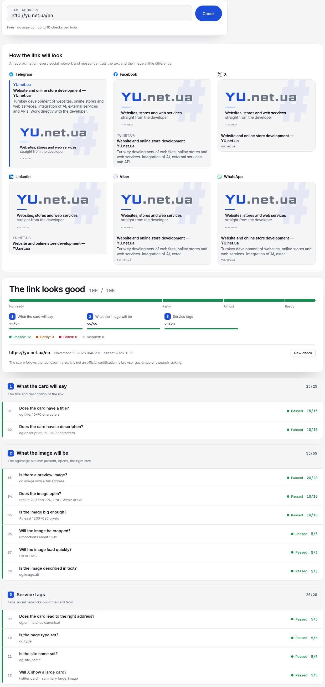

# Link Preview

[](LICENSE)
[](composer.json)
[](composer.json)
[](composer.json)
[](https://yu.net.ua/en/tools/link-preview)

A Livewire tool for Laravel that shows how a link will look when it's shared, then checks the tags the preview is built from. The visitor enters a URL and sees approximate preview cards for Telegram, Facebook, X, LinkedIn, Viber and WhatsApp, followed by a checklist of what to fix.

It needs no AI. The tool reads Open Graph and Twitter tags, the title, the description and the canonical URL. It downloads the `og:image` to measure its real size and weight.



**🔗 Live example: [yu.net.ua/en/tools/link-preview](https://yu.net.ua/en/tools/link-preview)**

## What it checks

12 checks in three groups. The result is a score out of 100 and a verdict.

| Group | Checks |
|---|---|
| **What the card will say** | Title, description |
| **What the image will be** | `og:image` present, opens, big enough, won't be cropped, loads quickly, has alt text |
| **Service tags** | `og:url` matches the canonical address, `og:type`, `og:site_name`, large card on X (`twitter:card`) |

After the report, a short guide explains how to refresh a cached preview: Facebook Sharing Debugger, LinkedIn Post Inspector and Telegram's @WebpageBot.

## Requirements

- PHP ^8.4
- Laravel ^13.0
- Livewire ^4.0

## Installation

```bash
composer require yu-laravel/laravel-link-preview
```

This also installs [`yu-laravel/laravel-web-tools-core`](https://github.com/yuriyakishin/laravel-web-tools-core). Both service providers are discovered automatically.

## Usage

Put the component on a page whose layout includes `@livewireStyles` and `@livewireScripts`:

```blade
<livewire:link-preview />
```

Import the styles into your CSS build:

```css
@import "../../vendor/yu-laravel/laravel-web-tools-core/resources/css/web-tools-core.css";
@import "../../vendor/yu-laravel/laravel-link-preview/resources/css/link-preview.css";
```

To match your site's colours and fonts, override the `--wt-*` variables (see [Web Tools Core](https://github.com/yuriyakishin/laravel-web-tools-core#styles)).

## Configuration

| Env variable | Default | Description |
|---|---|---|
| `LINK_PREVIEW_ENABLED` | `true` | Turn the tool off without uninstalling it. |
| `LINK_PREVIEW_PER_HOUR` | `10` | Checks per visitor IP per hour. |

A report is cached for 2 minutes, so a fix shows up on the next check. `config/link-preview.php` also limits the page size (2 MB) and the image size (8 MB). Page fetching (timeouts, redirects, user agent) is set in [Web Tools Core](https://github.com/yuriyakishin/laravel-web-tools-core#configuration).

## Events

After every check the tool dispatches `Yu\WebToolsCore\Events\ToolCheckedEvent` with `tool = "link-preview"` (see [Listening to checks](https://github.com/yuriyakishin/laravel-web-tools-core#listening-to-checks)).

## Languages

13 translations: cs, de, en, es, fr, it, ja, nl, pl, pt, tr, uk and zh. The language is taken from the visitor's browser, with your app locale as the fallback.

## Limitations

The cards are neutral approximations of each network's layout, without brand logos. A network can still crop or cache an image its own way.

## Author

Yuriy Akishin:
- 🌐 Website: https://yu.net.ua
- 📧 Email: yuriy.akishin@gmail.com
- 💼 LinkedIn: https://www.linkedin.com/in/yuriyakishin/
- 💻 GitHub: https://github.com/yuriyakishin

## License

MIT. See [LICENSE](LICENSE).
